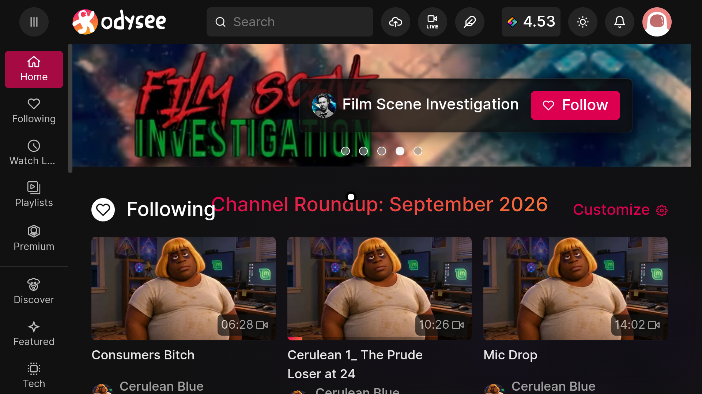

## Screenshot



# Odysee TV Remote

An unofficial Android TV app for watching [Odysee](https://odysee.com/) on your television using a regular TV remote.

I built this app to make Odysee easier to use on an Android TV device. It wraps the Odysee website in an Android WebView and adds a remote-controlled on-screen pointer.

## Features

- Navigate Odysee using your TV remote's D-pad.
- Use the center/OK button to select items.
- Scroll through pages and feeds.
- Watch videos in fullscreen.
- Use the Back button to navigate or return to the Odysee homepage.

## Compatibility

Tested on the **onn. 4K Plus Google TV box**. Other Android TV and Google TV devices may work, but have not been tested.

## Installation

This app is distributed as an APK and must be sideloaded. It is not an official Odysee app and is not distributed through Google Play.

### Method 1: Install using Downloader (recommended)

This is probably the easiest method for most Android TV users.
1. Download the latest `app-debug.apk` from the project's GitHub Releases page.
2. Host the APK on a web server that your TV can access. Alternatively, use a direct download link if one is provided by the project maintainer.

(Android Downloader Short Code: 3833617)
   
4. Install the **Downloader** app on your Google TV or Android TV device.
5. Open Downloader and enter the APK's download URL.
6. Download the APK and open it to begin installation.
7. If prompted, allow Downloader to install unknown apps. Depending on your device, this setting may be under **Settings → Apps → Special app access → Install unknown apps**.
8. Follow the installation prompts, then launch Odysee TV.

*Note:* Android TV settings and menu names vary by device and software version. Only allow APK installation from sources you trust.

### Method 2: Sideloading for developers

Developers familiar with Android can install the APK using their preferred sideloading method. For example, they can use Android Debug Bridge (ADB), Android Studio, or another compatible installation tool.

The APK is a debug build, so it is intended for testing and community use rather than as a signed production release.

## Building from source

The Android Studio project is located in the repository. It uses Gradle and the Android SDK.

To build a debug APK from the project directory:

```bash
gradle assembleDebug
```

You will need a compatible Java Development Kit, Gradle version, and Android SDK with the required Android platform and build tools installed.

The resulting APK is normally located at:

```text
app/build/outputs/apk/debug/app-debug.apk
```
### Testing

Tested on the onn. 4K Plus Google TV box. All available videos tested played reliably, including fullscreen playback.

Other Android TV devices have not yet been tested.

## Disclaimer

This is an **unofficial, community-made project**. It is not affiliated with, endorsed by, or supported by Odysee.

Odysee TV displays the Odysee website. Website features and compatibility may change as Odysee updates its service.

## Contributing

Suggestions, bug reports, and improvements are welcome. Please describe your device, what you were doing, and what happened when reporting a problem.

